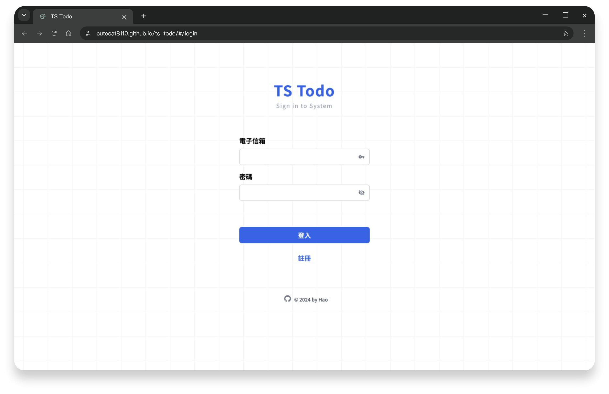

# TS Todo｜待辦清單


帳號註冊、待辦新增與編輯，支援完成狀態、篩選及鍵盤提交。

**[Demo](https://cutecat8110.github.io/ts-todo/#/login)** · [API 文件](https://todolist-api.hexschool.io/doc/)



<details>
<summary>使用說明</summary>

鑰匙可帶入測試帳號，待辦內容為共用。課程 API 每日凌晨 1:15 清除資料；帳號清除後可由登入流程重建。請勿保存重要或私人資料。

Enter 換行，Ctrl／⌘ + Enter 送出待辦。

</details>

<details>
<summary>開發、測試與部署</summary>

使用 `.node-version` 指定的 Node 22.23.3：

```bash
npm ci
# .env 已包含公開 API 網址；需要其他環境時可從範例建立 .env.local
npm run dev
npm run test
npm run type-check
npm run lint
npm run build
npm run preview -- --host 127.0.0.1
```

- `VITE_BASE_API` 為六角學院 API 根網址。`VITE_*` 都會進入公開建置，不能放入私人憑證。
- `src/config/demo-account.json` 是專用的**公開展示帳號**，供原有鑰匙按鈕帶入；不是管理員帳號，也不包含使用者私人帳密。此帳號的待辦是共用的；目前網站與課程 API 均不提供帳密修改功能。
- [課程 API](https://todolist-api.hexschool.io/doc/) 每日凌晨 1:15 清除資料。展示帳號被清除時，按「登入」會重建該帳號並登入；一般帳號仍使用原本的登入流程。請勿用展示帳號保存重要或私人資料。
- 保留原 Vue／TypeScript、Pinia、Tailwind 與 API 流程。錯誤會顯示可讀訊息，寫入不自動重送；清單讀取失敗可手動重試。
- 一般 Enter 保留換行；Ctrl / ⌘ + Enter 可提交新增或編輯中的待辦。輸入法組字、空白內容及按住快捷鍵不會重複送出。
- `npm run build` 會執行 TypeScript 檢查並輸出 `docs/`；發布使用 `main` 的 `/docs`。預設 `.env` 指向正式 API，發布前確認沒有 `.env.local` 覆寫。

### 隔離 QA

```bash
# 終端一：僅在 127.0.0.1:8095 運作的記憶體 API
npm run qa:api
# 終端二：明確選用本機 API
VITE_BASE_API=http://127.0.0.1:8095 npm run dev -- --host 127.0.0.1
```

Fixture 不會轉送正式 API；重啟會重設資料。Vitest 測試也只使用模擬 fetch，不會改動線上待辦。正式 API 的註冊與 CRUD 另行驗證，測試紀錄清楚分開。

修正編號、兩輪 QA 結果、RWD 量測與已知限制：[QA_CHANGELOG.md](QA_CHANGELOG.md)。

### 素材維護

Google Fonts 保持原字型／字重，載入連結維護於 `index.html`，避免重新加入 CSS @import 造成額外的請求發現等待。介面沒有大型點陣照片，路由分割與 API 邏輯保留。

</details>

<details>
<summary>技術與套件</summary>

[Vue 3](https://vuejs.org/) · [TypeScript](https://www.typescriptlang.org/) · [Pinia](https://pinia.vuejs.org/) · [Tailwind CSS](https://tailwindcss.com/) · [SweetAlert 2](https://sweetalert2.github.io/) · [VeeValidate](https://vee-validate.logaretm.com/v4/) · [Day.js](https://day.js.org/) · [VueUse](https://vueuse.org/) · [Iconify](https://iconify.design/)

</details>

[QA 紀錄](QA_CHANGELOG.md) · [介面設計規範](DESIGN_GUIDELINES.md)
